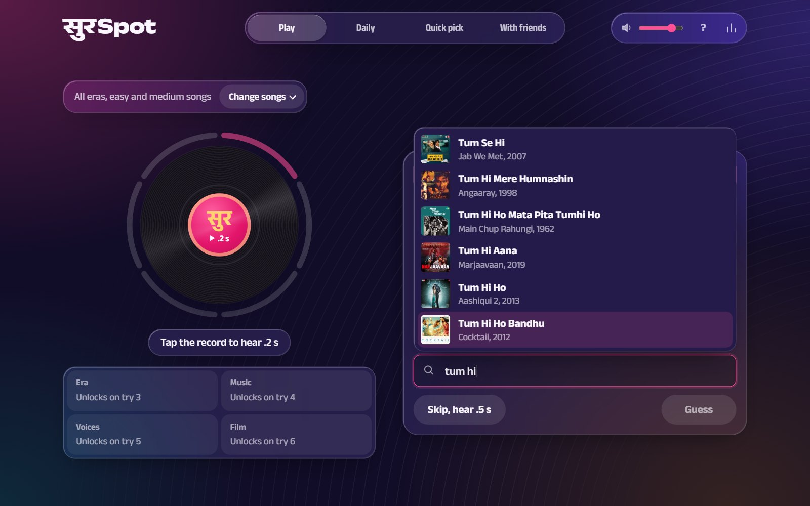
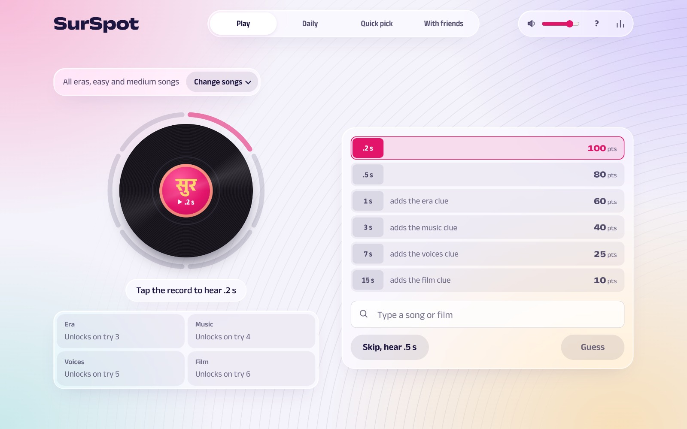
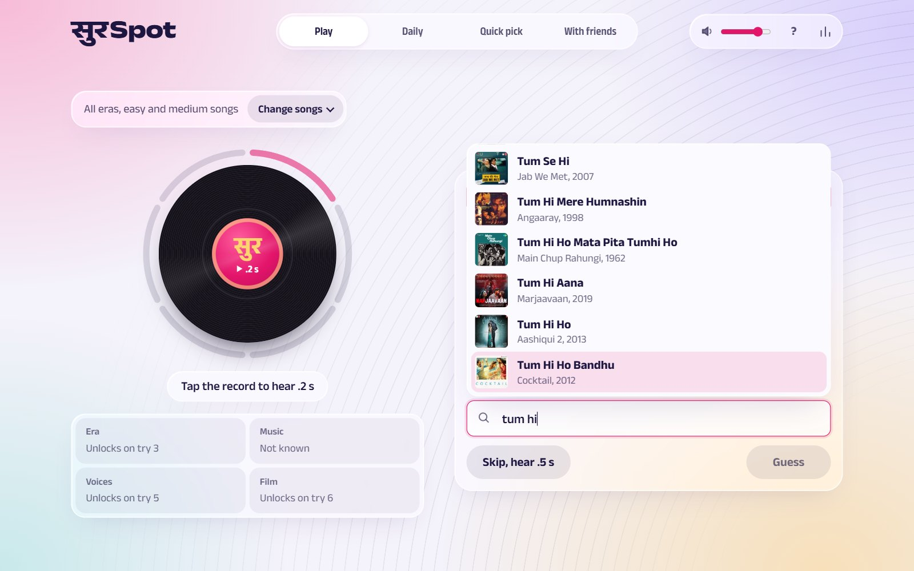
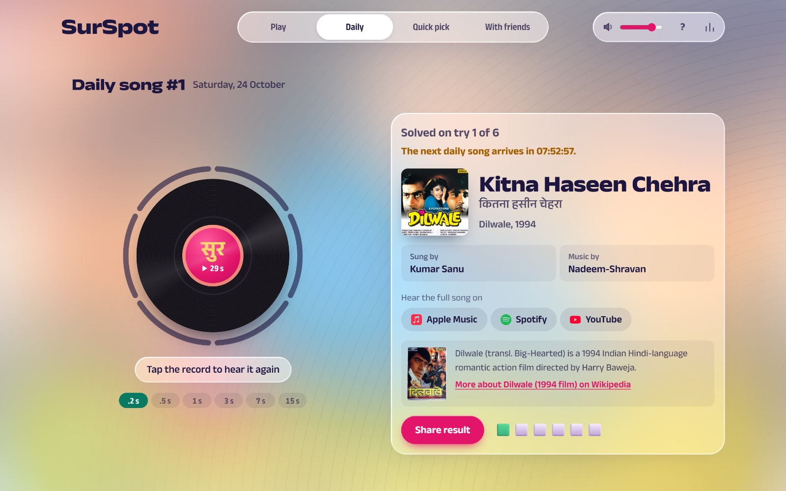
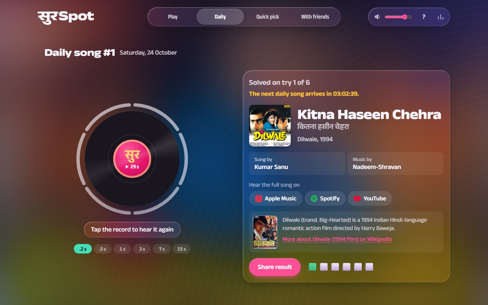
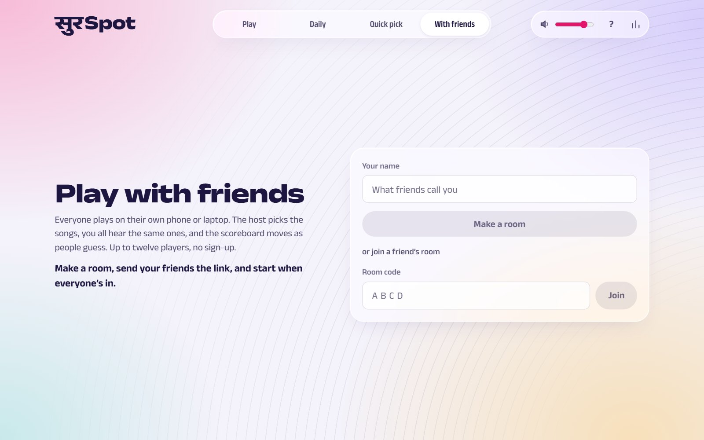
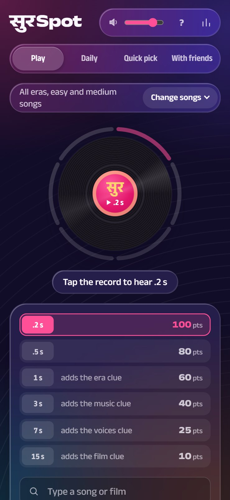
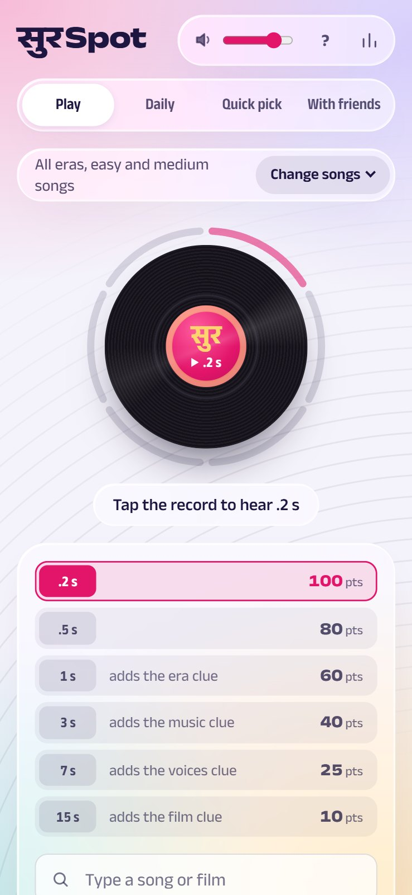

# सुरSpot

Name the song from a split second of it. SurSpot is a guess-the-song game for Hindi film music and Punjabi
music, from the 1950s to now. It runs in the browser: no app, no sign-up.

**Play it at [surspot.pages.dev](https://surspot.pages.dev)**

## How to play

Tap the record to hear the first 0.2 seconds of a song, then type the song or its film. Each round has six
tries, and every miss or skip plays a longer clip:

| Try | 1 | 2 | 3 | 4 | 5 | 6 |
|---|---|---|---|---|---|---|
| Clip | 0.2 s | 0.5 s | 1 s | 3 s | 7 s | 15 s |
| Points | 100 | 80 | 60 | 40 | 25 | 10 |

From the third try, clues open up: the era, the music director, the singers and the film. Naming the right
film with the wrong song is marked as the right film, so you know you're close, but it still uses a try. When the round ends, the answer card shows the song, its
cover, who sang and composed it, a note on the film from Wikipedia, and links to the full song on Apple Music,
Spotify and YouTube.

There are four ways to play:

- **Play**: endless songs from a pool you choose by era, mood, how well known the songs are, language
  (Hindi, Punjabi or both), and singer or composer.
- **Daily**: one song a day, the same for everyone, changing at midnight India time. Share your result as a
  row of coloured squares.
- **Quick pick**: ten songs, four choices each, fifteen seconds per answer.
- **With friends**: make a room and send the link. Everyone plays on their own phone or laptop, hears the same
  songs, and watches the scoreboard move. Up to twelve players, no accounts.

## Screens

| | |
|---|---|
|  |  |
|  |  |
|  |   |

The game follows your system's light or dark setting. After each round, the backdrop and menus take on the
colours of the song's cover.

## The songs

About 10,500 songs: 9,400 Hindi, mostly from films, and 1,150 Punjabi. Every song has a difficulty from Easy
(everyone knows it) to Expert (a deep cut), and a pool can mix any of them. About 1,200 songs were picked and
tagged by hand with moods and difficulty. The rest come from the soundtracks of the most-read Hindi films on
Wikipedia and the best-known tracks of Punjabi artists on Last.fm. Their difficulty is set by how many
Last.fm listeners they have, compared decade by decade with the hand-tagged songs, since a hit from 1965 has
far fewer listeners than one from 2015.

The audio is the 30-second preview that Apple's iTunes API provides for each track, played straight from Apple
and cut to exact lengths in the browser. SurSpot doesn't store or host any audio. The songs belong to their
rights holders.

## What gets counted

To know how many people play, the game sends a small anonymous note when you open it and when each song ends:
the mode, the song, whether you got it and on which try. It carries a random id made by your browser, never your
name, your guesses or anything else about you, and your country comes from the connection. Blocking it changes
nothing in the game.
